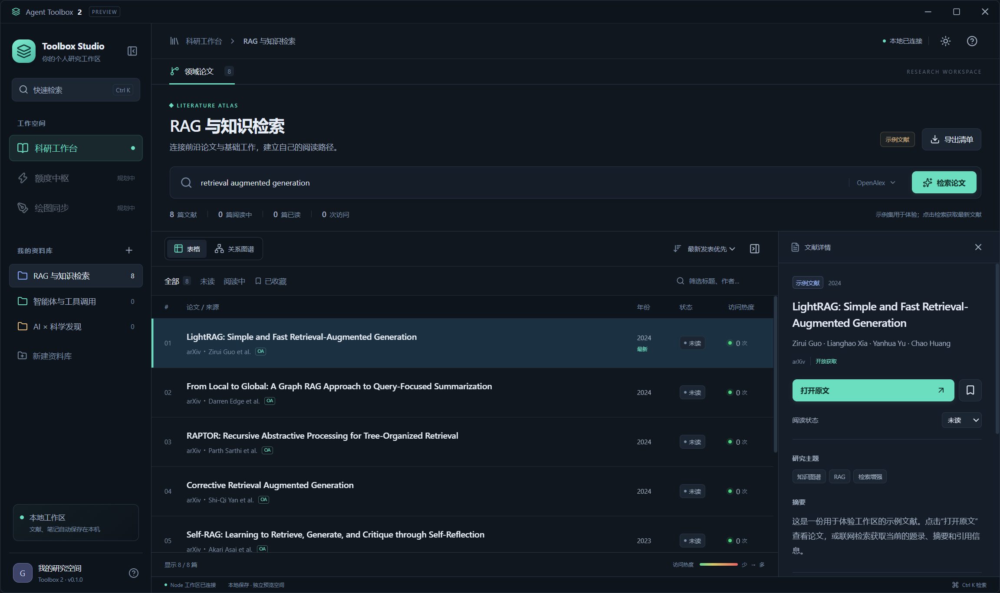
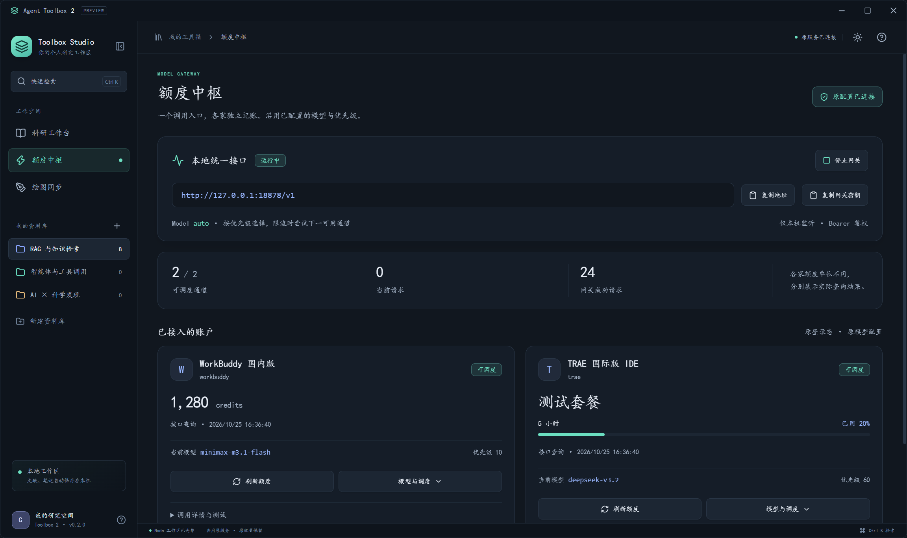
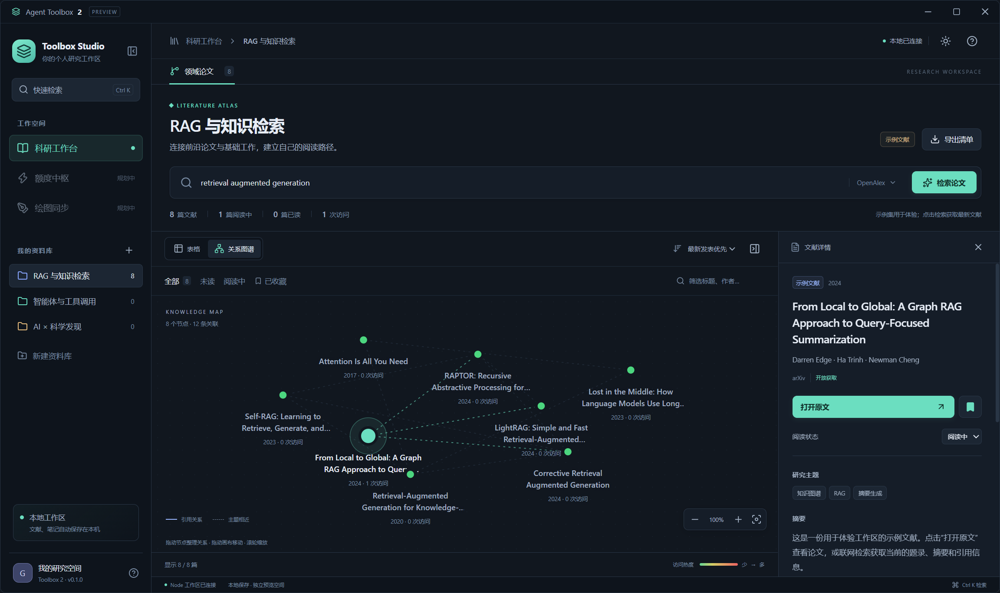

# Agent Toolbox 2

**一个围绕研究任务组织的桌面工作区。**

React + TypeScript 界面、独立 Node.js 工作区服务、Electron 桌面外壳。Windows 预览版 **0.3.0** 包含科研工作台、额度中枢、绘图同步，以及科研工具、DSH、容器和 Skill 管理的兼容入口。



## 当前可以体验

- 多资料库：按领域、交叉方向或研究问题组织论文。
- 联网检索：通过 OpenAlex 获取题录、摘要、主题及引用记录，按发表日期从新到旧排列，排除未来出版日期。
- 两种视图：表格比较文献；关系图支持拖动节点、平移和缩放。实线来自题录中的引用记录，虚线来自主题词重合。
- 阅读记录：点击次数从绿逐渐转红；收藏、未读／阅读中／已读状态、自动保存的阅读笔记。
- 工作区交互：可折叠侧栏、可调整宽度的详情面板、深浅主题、Ctrl K 检索、Markdown 阅读清单导出。

首次启动内置 8 篇 **明确标注的示例文献**，便于离线体验。示例集不是最新论文榜单，引用次数也不作演示性估算；点击检索后显示实际数据源返回的记录。

### 额度中枢

从左侧「额度中枢」进入，连接旧工具箱现有的 WorkBuddy、TRAE IDE、豆包工作和 QwenWork 通道。可查看各家的实际额度快照、刷新额度、选择已有模型、调整优先级与启用状态，控制本地统一网关，复制地址和网关密钥。测试按钮会明确提示消耗少量额度。

`auto` 沿用旧网关的优先级与限流回退策略；各家额度分别展示，不混加不同单位，也不把未知余额当作零。账号管理和重新授权暂时在原工具箱中完成。



### 绘图同步

从左侧「绘图同步」进入，点击「打开绘图本并启用同步」。复用原设备 ID、端口、配对凭据、笔迹与图片，现有 iPad 绘图本无需重新安装或签名。电脑画布支持图片导入／粘贴、钢笔、高亮、橡皮、套索和导出；iPad 继续使用已安装的原生 PencilKit 画笔、图片素材栏与涂划擦除。

配对二维码默认收起，点击「配对设备」才展开；检测到 iPad 连接后自动收起。已配对设备在地址仍可达时可用原信息重连，换网络／IP 后可重新扫描更新地址。界面区分电脑画布连接和远端设备连接，不把电脑自己算成 iPad。

### 科研工具、DSH、容器和 Skill

「完整科研工具」列出原有 15 个科研子页，并可查看现有文献目录、打开论文文件。选择复杂子页时会打开原工具箱对应页面，继续使用原阅读器、论文讲解、Zotero、自动科研和图板；领域论文也可继续在 V2 科研工作台使用新表格与关系图。科研套件的复杂编辑器尚未原生改写成 React，界面会切到原窗口。

「DSH 控制台」在 V2 内启动并显示原 DSH Web，沿用原插件、web profile 和 DS Bot 开关。内嵌控制台使用一次性登录 URL；重启 DSH 后会重新载入。完整的原面板也可一键打开。

「容器」直接浏览原资料目录，可导入文件、新建文件夹、编辑受支持文本、按类型整理，以及启动/停止识别出的项目。启动按钮只在用户点击时运行项目命令。旧版的依赖管理、AI 分类和其它高级菜单仍可从「原版完整界面」进入。

「Skill 管理」读取现有个人 Skill 目录和 DSH Skill 目录，支持预览、复制，以及粘贴完整 SKILL.md 或普通操作说明后安装。普通文字会补齐基础 frontmatter；重名时拒绝覆盖。旧版的 AI 蒸馏、收藏和 MCP 编辑仍可从「原版完整界面」进入。

**这些兼容模块需要已安装的旧工具箱 0.46.26 运行，并安装本仓库提供的桥接补丁。** V2 控制现有服务，不在另一个进程中重新解密账号或同时写同一份绘图本。关闭 V2 不会主动停止旧版的网关或绘图服务；退出旧版会断开这些服务，V2 会显示重新连接入口。参见 [迁移与恢复说明](docs/legacy-migration.md)。



## Windows 直接打开

本地构建输出：`release/Agent-Toolbox-2-Preview-0.3.0-win-x64.exe`。

这是便携式桌面程序，双击即可打开；使用者无需额外安装 Node.js。GitHub Actions 的 Windows 构建会上传 EXE 到工作流 artifacts。源码仓库不存放打包后的大体积二进制。

V2 的领域论文数据单独保存在 `%APPDATA%/AgentToolbox2Preview/workspace.json`。关闭并重开程序后，资料库、笔记、点击次数和界面偏好会恢复。原科研套件、容器、Skill、DSH、额度账号和绘图本继续由原程序及原目录管理，支持 Windows 目录联接；旧字体风格只读取并应用，不向原配置写入默认值，也不复制 Key 或生成新配对。

## 开发与构建

需要 Node.js 24 和 npm。

```sh
npm ci
npm run dev        # Vite + Electron 开发预览
npm run build      # TypeScript 检查、前端构建、后台编译
npm test           # 独立目录中的后台集成测试
npm run test:ui    # 原生 Electron 页面检查，使用临时工作区
npm run test:migration # 模拟旧服务的原生 UI 检查，不读取真实账号或配对
npm run dist:win   # Windows x64 便携 EXE
```

`npm run test:ui` 与 `test:migration` 使用隔离示例数据生成 README 截图，不读取个人资料库、账号或配对。后台测试覆盖认证、持久化、检索失败保留数据、恢复备份，以及桥接认证、操作边界和密钥保护。ZCOOL KuaiLe 字体的 SIL OFL 许可证随字体保存在 `assets/fonts/`。

## 项目结构

```text
src/          React 工作台、表格、图谱与详情面板
shared/       UI 与后台共享的类型定义
backend/      Node HTTP 服务、题录检索、独立文件存储
electron/     窗口、受限 preload 桥接、后台进程生命周期
compat/       旧工具箱进程内的受限控制器和可复现源码补丁
scripts/      构建、开发与页面检查
test/         后台集成测试
```

前端通过有限的 preload 方法调用应用功能，不直接访问文件系统。Node 服务仅绑定本机随机端口，并使用每次启动重新生成的令牌；令牌不暴露给页面。窗口与文献数据服务分离，为后续替换桌面外壳保留边界。

旧版兼容控制器同样只监听本机随机端口并鉴权，拒绝浏览器来源。管理令牌仅由 Electron 主进程读取；通道原密钥不返回页面，网关密钥仅通过原服务写入剪贴板。绘图画布只允许嵌入固定 `127.0.0.1:43128` 地址，沿用原局域网绘图协议。生产功能不依赖 DevTools／CDP。

联网检索取决于 OpenAlex 的收录、网络和服务限流；出版时间用于排序，不等同于论文质量或创新性判断。检索失败时保留上次文献，数据源缺失的摘要会如实显示为未提供。
